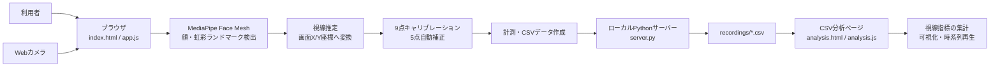

# MediaPipe Face Mesh Eye Tracker

MediaPipe Face Mesh を使ったブラウザ内アイトラッキングアプリです。Face Mesh の虹彩ランドマークから目の特徴量を作り、9点キャリブレーションで画面座標へ変換します。

## 3D射撃と視線計測をまとめて使う

研究用の統合版はデスクトップの **「3D射撃・視線研究」**、または次のコマンドで起動します。

```powershell
.\start-shooting.ps1
```

`http://127.0.0.1:8780/index.html?study=shooting` が開きます。Pythonはローカル配信と保存に使用し、カメラ・校正・3D描画・記録は同じブラウザ画面で動きます。カメラの起動はHTTPの `localhost`・`127.0.0.1`・`[::1]`、またはHTTPSに対応しています。HTMLファイルを直接開く `file://` では起動できません。Aim LabやPython版のカメラアプリは起動せず、カメラを使うほかのアプリは閉じてください。既存サーバーを使う場合は `python server.py` を再起動して新しいAPIを反映します。

1. 「条件入力・9点校正」で参加者ID、セッション番号、頭部条件、視力矯正、画面実寸、観察距離、マウスDPI、感度、乱数シードを入力します。カメラ未開始なら自動で許可を求めます。
2. 全画面で9点を各5回クリックします。中央の参考スコア測定後、自動で5位置の短時間正確度確認（約9秒）に進みます。各点1800msのうち600〜1800msを解析し、処理終了が区間を越えたサンプルは除外します。各位置3サンプル以上を必須にしていますが、これは精度の合格基準ではありません。結果の平均は位置平均の等重み平均、95%点は全有効サンプルのCSS px誤差をまとめた線形補間値です。
3. 必要なら「5点補正」を実施し、「正確度を再確認」します。校正・補正が変わると前の正確度確認を無効にします。結果を研究条件として適切と判断したら確認欄にチェックします。
4. 「射撃と計測を開始」でマウスポインタのロックを許可すると、3秒のカウントダウン後、60秒の射撃と同時計測を行います。球に命中すると次の球が現れます。カメラプレビュー・視線カーソル・操作パネルは隠します。感度はrad / mouse movement CSS px、縦FOVは65°、球の半径はワールド座標0.42で固定します。
5. 終了すると `recordings/shooting/<実行ID>/` に自動保存します。Esc・全画面解除・フォーカス喪失・表示サイズ変更・250ms超の描画間隔では途中終了として保存し、同じ記録を再開しません。次のセッションは再校正します。
6. 結果の「分析・時系列再生」から保存済み記録を直接開けます。ダウンロードした全記録JSONも `shooting-analysis.html` で読み込めます。

| ファイル | 内容 |
| --- | --- |
| `session.json` | 全データ、条件、校正・正確度確認の生データ、コード・検出モデル資産のSHA-256、集計 |
| `gaze.csv` | 未加工／最終視線、検出失敗、映像時刻、処理開始／終了、対応する描画・球、AOI判定 |
| `frames.csv` | 描画のCPU側開始／終了、カメラ位置・姿勢・FOV、球の3D／画面座標・半径・可視状態 |
| `targets.csv` | 球ごとの初回描画・命中・終了時刻、射撃／命中応答時間、視線到達推定、未完了／中断 |
| `shots.csv` | すべての左クリック、受付の有無・理由、命中／外れ、判定時のカメラ姿勢、直前の描画ID |
| `events.csv` | カウントダウン、課題開始、出現要求・初回描画・命中・終了・中断・欠測関連イベント |

記録形式は `gaze-shooting-1.0.0` です。保存済みの同一IDを別の内容で上書きしません。保存失敗時は再試行か全記録JSONのダウンロードができます。ブラウザのIndexedDBに約5秒ごとの復元用チェックポイントを保存し、未保存の終了記録も保持します。再読み込み後に「未保存記録を復元」すると、最後のチェックポイントまでの途中記録、または終了時の全記録を復元します。ブラウザの保存領域が利用できない場合や強制終了直前の最大約5秒分は回復できないことがあります。起動元のlocalhostポートやブラウザを変えると復元領域も変わります。

ソフトウェア上の時刻は同一の `performance.now()` に揃えます。球の出現時刻は最初の `renderer.render` が戻った時刻であり、実画面の発光時刻ではありません。新しい球はその初回描画後から命中を受け付けます。マウス移動後・次の描画前の射撃もあるため、射撃判定時の姿勢と直前の描画IDを別々に保存します。カメラの撮像・視線推定遅延の補正や厳密な同期は保証しません。

視線は処理開始より前の直近の描画に対応づけます。描画が200msより古い場合、球の終了をまたいで処理した場合、未検出の場合は球との距離・AOI解析から除外します。球内の判定はカメラ姿勢を使う3Dレイと球の交差で行い、誤差許容付き領域は投影した球の近似半径に正確度確認の95%点（CSS px）を足した円です。視線到達はこの領域への最初の侵入という推定値で、認識・注視の確定ではありません。命中時の視線距離は直前100ms以内の有効処理フレームがある場合だけ求めます。

球の配置用乱数は音・演出用から分離します。配置はカメラに対して画面内に収まる候補を生成し、部屋の範囲に制約するため、実際の3D位置はマウス操作にも依存します。厳密な再生には記録した描画・カメラ姿勢・球位置を使います。

Python版Face Landmarkerとブラウザ版Face Meshは検出・校正方式が異なります。正確度は統合版で改めて評価してください。5位置チェックは27試行の正確度検証の代替ではありません。頭部非固定の視角は開始位置・入力距離に基づく参考値です。

実装検証：

```powershell
node --test tests/shooting-core.test.js
python -m unittest discover -s tests -p 'test_*server.py'
node tests/shooting-browser.cjs
```

ブラウザテストはPlaywrightのある環境で実行し、必要なら `PLAYWRIGHT_MODULE` にモジュールの絶対パスを指定します。模擬カメラと保存APIのモックを使い、実験記録は作成しません。

## システム構成図



- `index.html` / `app.js`: カメラ映像の表示、Face Mesh によるランドマーク検出、視線推定、キャリブレーション、計測を行います。
- `server.py`: ローカルサーバーとして画面を配信し、計測結果CSVを `recordings` フォルダへ保存します。
- `analysis.html` / `analysis.js`: 保存済みCSVを読み込み、注視安定率、視線移動、時系列再生を表示します。
- `mediapipe/face_mesh`: ブラウザ上で利用する MediaPipe Face Mesh のローカルファイルです。

## 使い方

1. ローカルサーバーを起動します。
2. ブラウザで表示されたURLを開きます。
3. `開始` を押してカメラを許可します。
4. `キャリブレーション` を押し、9つの点を見ながら各5回クリックします。
5. すべての点が黄色になったら、中央の点を5秒見続けて参考用の中央スコアを測定します。これは視角での正確度ではありません。
6. 必要に応じて `5点補正` を押し、1つずつ表示される5つの点を見つめてズレを自動補正します。
7. `計測開始` を押すと視線データの記録を開始します。
8. `計測停止・保存` を押すと、CSVが `recordings` フォルダに自動保存されます。
9. `CSV分析ページを開く` または `http://localhost:8000/analysis.html` から分析ページを開きます。
10. 保存したCSVを `CSV読み込み` から選択すると、注視安定率、サッカード頻度、探索範囲、中心依存度、視線分布エントロピー、時系列再生つきの軌跡、フェーズ別パターンを表示できます。
11. 分析ページでは `注視安定率 = 安定サンプル数 / 全サンプル数` を表示します。安定サンプルは速度が注視しきい値以下の行です。この指標からゲームの熟練度を判定する機能はありません。
12. 分析サンプル、注視安定率、サッカード頻度、探索範囲、中心依存度、視線分布エントロピーは `詳細指標を表示` ボタンで開閉できます。

CSVには、計測中のサンプル番号、取得時刻、経過時間、フェーズ、X/Y座標、前サンプルからの移動量、移動距離、速度、画面サイズが保存されます。

## 起動例

```powershell
.\start-server.ps1
```

その後、ブラウザで `http://localhost:8000/` を開きます。

`index.html` を直接開く `file://` では動きません。URLは `http://localhost:8000/` を使ってください。

## 視角での正確度検証

参加者ごとの実施計画は公開対象に含めていません。実施条件は下記の手順と実際の測定環境に合わせて設定してください。サーバーを既に起動していた場合は、新しい保存APIを反映するため `python server.py` を再起動し、ページも再読み込みしてください。

1. `開始` でカメラを起動します。通常のCSV計測は停止しておきます。
2. `1. 条件入力・全画面で校正` を押し、参加者ID、セッション番号、視力矯正、画面実寸、観察距離、環境の記録を入力します。初期値は29.5×16.7cm、30cm、1920×1080pxです。
3. 頭部条件を `固定する` / `固定しない` から選択します。選んだ条件と開始位置・距離の確認欄にチェックし、`全画面にして9点校正を開始` を押します。校正から検証終了まで同じ頭部条件で実施します。
4. 中央の参考スコア測定（5秒）が終わるまで待ちます。`5点補正` は任意で、実行しなくても検証を開始できます。
5. `2. 検証を開始` を押すと、3秒のカウントダウン後、9位置×3回（27試行、約81秒）の検証が始まります。表示される点の中心を見続けてください。
6. 終了後に位置別の角度誤差とデータ取得状況を表示し、`recordings/validation/<実行ID>/` に4ファイルを自動保存します。次のセッションは条件入力から再校正します。

`2. 検証を開始` は、検証用の条件が未入力なら準備画面を開きます。通常のキャリブレーションや的クリック課題の校正だけでは、検証用の条件入力の代わりにはなりません。検証用の校正後に全画面を解除した場合は、このボタンで全画面に戻り、校正時と同じ表示サイズであることを確認してから開始します。サイズが違う場合や校正が切り替わった場合、前回の検証が終了している場合は準備し直す画面に案内します。カメラ未開始・一時停止・校正中・通常CSV計測中・別課題実行中・保存中は開始できず、ボタンの上に理由を表示します。

5点補正の有無はJSON・CSVの `five_point_correction_applied` に保存します。補正あり・なしは異なる条件として扱い、セッション比較で同じ範囲に集計しません。

頭部条件はJSON・全CSVの `head_condition`（`fixed` / `free`）に保存し、結果と比較表にも表示します。セッション番号1〜3は頭部条件ごとに使用でき、比較は参加者・頭部条件ごとに集計します。古い記録で条件が未記録の場合は「不明」として分けます。

非固定条件の角度は、開始時の中央正面の目の位置と入力距離に基づく参考値です。動いた後の目の位置・距離は測定していません。計算の前提は `angular_error_reference` に記録します。固定の効果を調べる場合は、同じ参加者で両条件を測定し、照明・距離・5点補正の有無など他の条件を揃えてください。

検証終了・中断時は全画面を自動解除します。結果画面はEscで閉じられ、`検証結果・過去の結果を比較` から再表示できます。閉じても保存処理や結果データは失われません。

検証中は学習・補正を停止し、視線カーソル、軌跡、ヒートマップ、プレビューを隠します。Esc、全画面解除、ウィンドウのフォーカス喪失、非表示、画面サイズ変更、250msを超える描画間隔があった場合は中断します。中断試行は主解析から除外しますが、そのフレームと理由は保存します。カメラの未検出はそれだけで中断せず、失敗フレームとして記録します。

| ファイル | 内容 |
| --- | --- |
| `session.json` | 環境、校正モデルと設定、コードのSHA-256、乱数シード、提示順、イベント、全フレーム、集計を含む全記録 |
| `samples.csv` | 目標座標・提示時刻、処理時刻、未加工/最終出力座標、角度誤差、検出失敗、解析対象フラグ |
| `trials.csv` | 試行別の平均・95パーセンタイル誤差、処理フレーム基準の失敗率、有効サンプル/秒、最大取得空白 |
| `positions.csv` | 位置別の試行数、平均・95パーセンタイル誤差、有効サンプル数、処理フレーム基準の失敗率 |

CSVの座標はCSS pxです。視角は全画面の実際のCSS幅・高さと画面実寸から2本のベクトルのなす角で計算します。画面解像度は記録用で、1920をCSS幅と決めつけません。主評価は制限・平滑化・丸め後の最終出力、未加工座標は比較用です。空欄の角度誤差は算出不能を表し、ゼロとは区別します。

保存先の実行IDは一意で、同じ記録の再保存は可能ですが、違う内容による上書きは拒否します。自動保存に失敗した場合は再試行するか、結果画面から全記録JSONをダウンロードしてください。JSONにはCSVを再構成するための情報も入っています。未保存のままページを閉じないでください。

`検証結果・過去の結果を比較` から複数の `session.json` を読み込み、参加者ごとのセッション平均と範囲を比較できます。同じセッション番号の複数実行や異なる条件は自動で統合しません。

対応ブラウザでは `requestVideoFrameCallback` の映像時刻・フレーム番号を記録し、新しい映像ごとに処理します。非対応時は `video.currentTime` の変化による近似的な重複対策に切り替え、各行の `frame_source` で区別します。処理時刻は `performance.now()`、標的提示時刻は描画コールバック内のCSS更新時刻です。撮像の露光時刻や実画面の発光時刻を測定したものではなく、この機能だけでは装置遅延やAim Labとの同期を保証しません。

### 検証結果の表の読み方

1試行は1つの目標点を3秒間見る区間です。同じ位置を3回ずつ測ります。誤差の主解析には、完了した試行の後半2秒（提示から1秒以上・3秒未満）を使います。最初の1秒、途中で中断した試行、処理終了が解析区間の終わりを越えたフレーム、推定に失敗したフレームは誤差の集計から除外します。

| 表示項目 | 意味・計算方法 | 読み取り方 |
| --- | --- | --- |
| 位置 | 注視目標の位置ID（V1〜V9）。配置は下表のとおりです。 | 提示順ではなく画面上の場所を表します。提示順はランダムです。 |
| データあり試行 | その位置の予定3試行のうち、完了し、主解析に使える有効サンプルが1件以上あった試行数。 | `3/3` は3回すべてから誤差を計算できたという意味です。各試行の全フレームが取得できたことや、正確度が十分であることは保証しません。 |
| 平均誤差 | 目標点と最終出力の視線座標との視角誤差（°）。まず試行ごとに有効サンプルの誤差を平均し、次にその位置のデータあり試行の平均を等しい重みで平均します。 | 小さいほど目標に近い推定です。サンプル数が多い試行だけが強く反映されない集計です。欠測があれば残った試行だけの平均なので、データあり試行も確認してください。 |
| 95%点 | その位置の全有効サンプルをまとめた誤差の95パーセンタイル（°）。小さい順に並べ、順位 `(サンプル数 − 1) × 0.95`（0始まり）の前後を線形補間します。 | おおむね95%のサンプルがこの誤差以下になる目安です。大きなズレの程度を見る指標で、最大値や「95%信頼区間」ではありません。試行別95%点の平均でもありません。 |
| 未加工平均 | 画面内への座標制限・平滑化・丸めを行う前の推定座標を使った平均視角誤差（°）。平均誤差と同じ有効サンプル・試行の重み付けで計算します。 | 最終出力の平均誤差と比べ、出力処理で値がどう変わったかを確認できます。「校正前」や「5点補正前」の値ではなく、そのセッションの校正モデル（実施した場合は5点補正も含む）による推定値です。 |
| 検出失敗率 | その位置の完了試行の後半2秒について、`無効フレーム数 ÷ 処理フレーム数 × 100`。顔・特徴量の未検出や、有限の座標を推定できなかったフレームなどを失敗として数えます。 | 小さいほど、処理できた映像から座標を得られた割合が高いことを示します。座標の正確さとは別の指標です。カメラ停止や処理が追いつかず未処理になった映像は分母に入らないので、0%でも欠測がないとは限りません。 |
| 有効サンプル | その位置で主解析の誤差計算に実際に使った視線サンプル（フレーム）の合計数。 | 参加者数・試行数ではありません。少ない場合はデータ不足に注意し、試行別CSVの取得頻度・最大取得空白も確認してください。多いだけで正確度が高いとはいえません。 |

位置は画面の左上を基準に、横・縦それぞれ12%、50%、88%の場所です。

| 縦位置 ＼ 横位置 | 左：12% | 中央：50% | 右：88% |
| --- | --- | --- | --- |
| 上：12% | V1（左上） | V2（上中央） | V3（右上） |
| 中央：50% | V4（左中央） | V5（中央） | V6（右中央） |
| 下：88% | V7（左下） | V8（下中央） | V9（右下） |

例えば同じ位置の3試行の平均誤差が1°、2°、3°なら、位置の平均誤差は `(1 + 2 + 3) / 3 = 2°` です。95%点が4°なら、おおむね95%の有効サンプルの誤差が4°以下だったと読みます。これは「95%の確率で正しく見ている」という意味ではありません。

表示上の `—`（CSVでは空欄）は算出不能であり、誤差0°や失敗率0%とは違います。結果上部の全体平均は、27試行が完了して全9位置が `3/3` の場合だけ、9位置の平均誤差を等しい重みで平均して表示します。角度の表示は小数第2位までに丸めるため、画面上の `0.00°` も必ずしも誤差が厳密にゼロとは限りません。

検出失敗率の分母には、後半2秒に処理を開始したものの処理終了が区間末尾を越えたフレームも含みます。一方、そのようなフレームは有効サンプルには数えません。そのため、`1 − 有効サンプル数 / 処理フレーム数` が検出失敗率と一致するとは限りません。

これらは目標点を実際に注視していることを前提とした評価です。頭部非固定の角度は開始時の目の位置・入力距離に基づく参考値であり、動いた後の実際の視角誤差ではありません。この表だけでゲームの熟練度や敵の認識速度、合否は判定しません。

### 開発時の確認

```powershell
node --test tests/validation-core.test.js
python -m unittest discover -s tests -p 'test_*.py'
```

ブラウザの通しテストは、Playwrightを利用できる環境でサーバーを起動して `node tests/validation-browser.cjs` を実行します（WindowsではEdgeを使用）。必要なら `PLAYWRIGHT_MODULE` にPlaywrightのモジュールパス、`VALIDATION_URL` にローカルサーバーURLを設定します。カメラとFace Meshは模擬入力に置き換え、保存APIもモック化するので実験記録は作成しません。これは機能テストであり、実機の注視点正確度を示すものではありません。

## Aim Labでのクリック課題と視線記録

Aim Lab本体を操作する課題には、Windows用の専用記録アプリ `aimlab.py` を使います。カメラ処理はPythonの別スレッドで継続するため、Aim Labが前面でも、記録アプリが最小化されても記録できます。ブラウザの簡易課題とは別の記録形式です。

```powershell
.\start-aimlab.ps1
```

初回は `.aimlab-venv` に固定版の依存ライブラリを導入し、Googleの公式Face Landmarkerモデルを `.aimlab-models` にダウンロードします。Python 3.11〜3.13が必要です。通常サーバーのPython環境とは分離しています。カメラ指定は `-Camera 1` などを付けます。実行ポリシーで止まる場合は `powershell -ExecutionPolicy Bypass -File .\start-aimlab.ps1` を使えます。

1. ブラウザの「ブラウザのカメラを停止」を押し、カメラを専用アプリに渡します。課題・検証・通常計測中は先に終了・保存してください。
2. 専用アプリで参加者ID・セッション番号・タスク名・感度/FOV・DPI・距離・頭部条件を入力します。
3. プライマリ画面で9点を各5回クリックして校正します。点が出てから0.8秒待ち、直近の新しい3フレーム以上の特徴量を平均して1クリックの校正データを作ります。別ウィンドウへ切り替えると校正は中止します。
4. Aim Labを同じ画面・解像度で開き、タスク直前に **F8** で視線記録開始、終了直後に **F9** で停止・保存します。**F10** は任意の時刻の目印です。
5. `recordings/aimlab/<実行ID>/gaze.csv` を既存の `analysis.html` で読み込めます。次のセッションは再校正します。

詳しい手順は `http://localhost:8000/aimlab.html` にあります。保存される4ファイルは `gaze.csv`（有効視線のみ、既存分析形式）、`samples.csv`（検出失敗を含む全処理フレーム）、`events.csv`（手動目印・前面アプリ名）、`session.json`（実施条件・校正モデル・コード/モデルのSHA-256・取得状況）です。カメラ画像は保存しません。CSVは行ごとにフラッシュし、実行IDは毎回新しく作成します。異常終了でJSONの状態が `recording` のままの場合は未完了記録として扱います。

9点校正ボタンが無効の場合は、画面上部の準備状況・エラーを確認します。「カメラを再接続」で再試行でき、番号と接続方式（`auto` / `MSMF` / `DirectShow`）を選べます。`auto` はMSMF、DirectShowの順に実際の映像を取得できる方式を試します。ドライバーの既定解像度を使用し、最初のフレームを処理できてから校正ボタンを有効にします。ドライバー呼び出しが応答しない場合はアプリを閉じて再起動してください。

座標はプライマリ画面左上原点の**物理ピクセル**で、ブラウザのCSS pxとは区別します。ブラウザの校正を転用せず、Face Landmarker用に校正し直します。物理座標で上限2600px/s、平滑化係数0.1〜0.48、デッドゾーン3.5pxを使用し、200ms超の空白・検出失敗後は平滑化をリセットします。ブラウザ版と検出モデル・校正/処理条件が違うので、同じ正確度とは見なしません。ゲームの表示がプライマリ画面全体を覆う設定を使い、解像度を途中変更すると記録を停止します。

Aim Labのスコア、命中判定、標的出現時刻は自動取得していません。Aim Lab側の結果を別に保存し、参加者ID・セッション番号・タスク名で対応づけます。手動目印はゲームと厳密な同期を保証せず、標的出現からの応答時間をこの記録だけで計算できません。処理時刻はカメラの露光時刻でもありません。前面アプリ名は1秒ごとの確認で、すべての切り替えを捉えるとは限りません。

依存関係とモデルの確認（カメラは開きません）：

```powershell
.\.aimlab-venv\Scripts\python.exe aimlab.py --check
.\.aimlab-venv\Scripts\python.exe -m unittest discover -s tests -p 'test_aimlab*.py'
node tests/aimlab-browser.cjs
```

モデル/APIの出典：[Google Face Landmarker Pythonガイド](https://developers.google.com/edge/mediapipe/solutions/vision/face_landmarker/python)。Aim Lab本体を前面にした実機での取得頻度・注視点正確度は、実験前に短い試行で確認してください。

## ブラウザの簡易クリック課題（旧）

静止した円形の的が1個ずつランダムに現れ、マウスで左クリックする課題です。Aim Lab本体との連携や同等性を保証する機能ではありません。正確度検証とは別に、クリック応答時間と探索中の視線軌跡を記録します。

### 開始と結果確認

1. サーバーを起動し、カメラの `開始` を押します。旧サーバーを起動中の場合は停止して `python server.py` で再起動してください（新しい `/save-aim` APIが必要です）。通常のCSV計測は停止しておきます。
2. `的クリック課題` の `1. 課題設定・全画面で校正` を押します。参加者ID、セッション番号、視力矯正、頭部固定・非固定、画面実寸、開始距離、環境・マウス設定を入力します。
3. 的の数（初期値30）、直径（48 CSS px）、1個の制限時間（3000 ms）を設定します。乱数シードは空欄なら自動生成して保存します。同じシード・課題設定・表示サイズなら同じ位置順と提示間隔を再現できます。
4. 開始位置・頭部条件の確認欄にチェックし、全画面にして9点校正を実施します。中央の5秒測定が終わると `2. 的クリック課題を開始` が押せます。5点補正は任意です。課題ごとに校正をやり直します。
5. 3秒のカウントダウン後、出現した的をできるだけ速く正確に左クリックしてください。外しても制限時間内なら狙い直せます。命中・時間切れで的が消え、0.5〜1秒の空白後に次の的が現れます。右クリック・タッチ・キーボード入力は得点対象にしません。
6. 終了後、全画面を解除して結果を表示し、`recordings/aim/<実行ID>/` にJSONと4種類のCSV（試行・視線・クリック・カーソル移動）を自動保存します。失敗した場合はサーバー保存を再試行するか、全記録JSONをダウンロードしてください。
7. 結果画面で試行を選ぶと、的・視線軌跡・カーソル軌跡・クリック位置を重ねて表示します。視線は最終出力座標と未加工座標を切り替えられ、カーソルは「カーソル軌跡を重ねる」で表示を切り替えられます。保存した課題の `session.json` を開いて、後から軌跡を確認することもできます。

課題中は校正モデル・平滑化設定を固定し、視線カーソル・軌跡・ヒートマップ・顔プレビューを隠します。マウスカーソルは表示します。Esc、全画面解除、画面サイズ変更、フォーカス喪失、ページ非表示、250msを超える描画間隔で中断し、途中のデータも保存します。Escで結果画面を閉じても記録は残ります。

### 設定パラメータの説明

以下は「課題設定・全画面で校正」で入力する項目です。初期値はページを新しく開いたときの値であり、研究用の推奨値・合格基準ではありません。準備を完了した時点の設定をその課題に使用し、実行中は変更しません。設定は全記録JSONの `metadata` に保存されます。

#### 課題の動作を決める項目

| パラメータ（保存名） | 初期値・入力範囲 | 意味・変更したときの影響 |
| --- | --- | --- |
| 的の数（`trial_count`） | 30個。1〜100の整数。 | 1回の課題で提示する的の総数です。命中だけでなく時間切れも1試行として数えます。増やすと取得できる試行数が増えますが、課題時間も長くなります。 |
| 的の直径（`target_diameter_px`） | 48 CSS px。16〜160の整数。 | 円形の的の見た目と命中判定の直径です。48なら中心から半径24 CSS px以内へのクリックが命中です。小さくするとクリック可能な範囲が狭くなります。画面の物理的な長さや視角ではないため、画面・ブラウザ倍率・OS拡大率が変わると見かけの大きさも変わり得ます。 |
| 1個の制限時間（`timeout_ms`） | 3000 ms（3秒）。500〜10000 ms、設定画面では100 ms刻み。 | 的が出てから命中を受け付ける時間です。外れクリックでは延長されません。制限時刻ちょうど以降のクリックは命中にしません。短くすると狙い直しに使える時間が減り、長くすると時間切れまでの待ち時間が増えます。 |
| 乱数シード（`seed`） | 空欄。指定する場合は0〜4294967295の整数。 | 的の位置順と、的が消えてから次に出るまでの待ち時間を生成するための番号です。例えば `42` を指定すると、同じ課題設定・表示サイズで同じ位置順・待ち時間の設定値を再現できます。空欄なら準備時に自動生成し、使用した番号をJSONに保存します。番号の大小は難易度を表しません。 |

同じシードでも、的の直径や表示サイズが違えば、余白や座標が変わる場合があります。また、次の的は前の的への命中または時間切れ後に出るため、シードを揃えても課題開始からの実際の出現時刻までは一致しません。

#### 参加者・測定条件の記録項目

| パラメータ（保存名） | 初期値・入力範囲 | 意味・注意点 |
| --- | --- | --- |
| 参加者ID（`participant_id`） | `P01`。半角英数字・ハイフン・アンダースコアで1〜32文字。 | 誰の記録かを区別する匿名IDです。同じ人には同じIDを使います。ID自体で課題の難易度や視線推定は変わりません。 |
| セッション番号（`session_number`） | 1。1〜999の整数。 | その参加者の何回目の課題かを記録します。終了後は設定欄が次の番号に進みます（上限999）。同じ番号を使っても実行IDは別ですが、解析で取り違えないように管理してください。 |
| 視力矯正（`vision`） | 裸眼。裸眼・眼鏡・コンタクトから選択。 | 実施時の状態を記録します。保存値は `unaided`・`glasses`・`contacts`。選択に応じた推定モデルの自動切り替えや補正は行いません。 |
| 頭部条件（`head_condition`） | 固定する。固定する・固定しないから選択。 | 校正から課題終了までの実験条件です。保存値は `fixed`・`free`。選択しただけで頭部の動きを検出・制御する機能ではありません。実際に固定するかどうかは実験者が準備します。 |
| 画面の幅（`width_cm`） | 29.5 cm。1〜300 cm、0.1 cm刻み。 | 枠を除く実際の表示領域の横幅です。この課題では条件の記録用で、入力値に応じて的のCSS直径を自動調整することはありません。 |
| 画面の高さ（`height_cm`） | 16.7 cm。1〜300 cm、0.1 cm刻み。 | 枠を除く実際の表示領域の高さです。幅と同じく条件の記録用です。 |
| 開始時の観察距離（`distance_cm`） | 30 cm。5〜300 cm、0.1 cm刻み。 | 課題開始時の目から画面までの距離です。条件の記録用で、距離の自動測定や移動後の追跡は行いません。この課題の応答時間・軌跡表示を視角に変換する設定でもありません。 |
| 環境・マウス設定・特記事項（`environment_notes`） | 空欄。最大1500文字。 | 照明、頭部固定方法、ブラウザ倍率、OS拡大率、マウスの機種・DPI・感度などを手入力します。ここに数値を書いてもOSやマウスの設定自体は変更されません。 |
| 開始位置・頭部条件の確認（`head_position_confirmed`） | 未チェック。準備開始にはチェックが必要。 | 選んだ頭部条件と開始位置・距離を用意したことを実施者が確認する欄です。機器による自動確認ではありません。 |

画面実寸・距離などの記録値と、実際に使用した全画面のCSS幅・高さ（`viewport_width`・`viewport_height`）は別に保存します。5点補正の有無は `metadata.tracker.five_point_correction_applied` に記録します。

#### 現在は設定画面から変更できない動作

| 項目 | 現在の設定 |
| --- | --- |
| 開始前カウントダウン | 3秒。クリックは記録しますが的への命中・外れには数えません。 |
| 的の間の空白 | 命中・時間切れ後に500〜1000 msのランダムな待ち時間。最後の的の後は待たずに終了します。 |
| 的の配置・移動 | 静止した的を1個ずつ提示します。中心は画面の各端から「的の半径＋20px」だけ内側の範囲に配置します。12%の出現制限はありません。 |
| 入力 | マウス左ボタンを押した時点で判定します。右クリック・タッチ・キーボード操作は得点対象外です。 |
| 描画停止による中断 | 描画の間隔が250 msを超えた場合に中断します。 |

例えば初期設定の30個・3000 msで全て時間切れになった場合、カウントダウンと的の間の空白を含む課題時間の設定上の目安は107.5〜122秒です（校正・描画遅延・保存時間は別）。命中すればその分短くなります。

頭部固定・非固定などの条件を比較する際は、調べたい項目以外の課題設定・表示条件・マウス設定を揃え、条件名や変更点を記録してください。シードを固定してもマウスの開始位置や実際の操作時間までは固定されない点に注意してください。

### クリック応答時間と記録内容

| 項目 | 定義・注意点 |
| --- | --- |
| 最初のクリック (ms) | 的の出現から、受付時間内の最初の左ボタン押下まで。外れでも記録します。未クリックなら空欄です。 |
| 命中まで (ms) | 的の出現から、円の内側への左ボタン押下まで。先に外した場合は狙い直しの時間も含みます。時間切れ・中断では空欄です。 |
| 平均・中央値 | 命中試行の「命中まで」の時間だけで計算します。時間切れを0 msとして扱いません。失敗が多い人の成功分だけの平均と、全試行成功した人の平均を単純に同等視しないでください。 |
| 外れ | 的の受付時間内に円の外を押した回数。外れてもその的の制限時間はリセットしません。 |
| 時間切れ | 設定した制限時間までに命中しなかった試行。制限時刻ちょうど、またはそれより遅いクリックは命中にしません。 |
| クリック命中率 | `命中クリック数 / (命中クリック数 + 外れクリック数) × 100`。カウントダウン中・的の間の空白・制限時刻以降のクリックは別に記録し、この分母には含めません。 |
| 有効視線サンプル | その的の表示中に処理を開始し、消去時刻までに処理が終了した、有効な推定座標の件数。未検出や空白があってもクリック結果は保持します。 |

| 保存ファイル | 内容 |
| --- | --- |
| `session.json` | 参加者・頭部条件・画面条件・課題設定、乱数シード、実際の提示順、校正モデル、5点補正の有無、コードのSHA-256、集計、試行・視線・クリック・イベントの全記録 |
| `trials.csv` | 的の中心・半径、出現・制限・消去時刻、命中・時間切れ・中断、最初のクリックと命中までの時間、外れ回数、視線取得数 |
| `gaze.csv` | カウントダウン・的の間の空白を含む課題全体の処理フレーム。処理開始・終了時刻、映像時刻、最終出力と未加工の視線X/Y、検出成否、対応する試行ID・目標座標・目標からの経過時間 |
| `clicks.csv` | 左ボタン押下の時刻・座標、イベントのタイムスタンプ、試行ID、的の座標、出現からの時間、`hit`（命中）・`miss`（外れ）・`between_targets`（提示前・間の空白）・`late`（表示が残っていても受付時間終了後）の区別 |
| `cursor.csv` | カーソル移動と左ボタン押下時の画面座標・時刻・試行ID。カウントダウン中・的の間の空白も含む。全記録JSONの `cursor` 配列にも同じデータを保存 |

#### カーソル移動の記録

課題のカウントダウン開始から終了・中断まで、マウスの `pointermove` を最大約60回/秒（移動サンプルの間隔は約16.7ms以上）で記録します。左ボタン押下時はこの間引きと別に必ず1点記録し、命中位置を残します。停止中は定期サンプルを生成しないため、サンプル間隔は一定ではなく、60 Hzの連続測定を保証するものではありません。動かす前の初期位置や、記録点間の細かな動きを後から補完することもありません。

| カーソル記録の列 | 意味 |
| --- | --- |
| `sample_id` | その課題内のカーソルサンプル連番 |
| `time_ms` / `elapsed_ms` | イベント処理時の `performance.now()` と課題開始からの経過時間（ms）。的・視線・クリックと同じ時刻基準 |
| `event_timestamp_ms` | ブラウザが通知したイベントの `timeStamp`。機器の物理的な移動時刻とは限らないため、上の処理時刻と分けて保存 |
| `x` / `y` | ブラウザ表示領域の左上を原点とするカーソル座標（CSS px）。生のマウスセンサー値や机上の移動距離ではない |
| `buttons` | そのイベント時のボタン状態のビットマスク（0＝押下なし、1＝左ボタンなど） |
| `sample_kind` | `move`＝間引き後の移動サンプル、`button_down`＝左ボタンを押した位置 |
| `trial_id` | イベント時に表示されていた的の試行ID。カウントダウン・的の間の空白では空欄 |
| `target_x` / `target_y` / `target_onset_ms` / `time_from_target_ms` | その的の中心座標・提示時刻・提示からの経過時間。的がなければ空欄 |

記録方式と間引き間隔は `metadata.cursor_recording` に保存します。結果図ではオレンジの破線がカーソル、黄色の線が視線です。カーソルも200msを超える記録間隔は線でつなぎません（停止中も間隔が空くため、線の切れ目だけで記録失敗とは判断できません）。視線の遅延は補償していないので、両軌跡の時間差をそのまま認識・運動の遅れと解釈しないでください。

カーソル記録追加前のJSONも読み込めますが、過去のカーソル移動は復元できず「カーソル移動データがありません」と表示します。新形式の5ファイルを保存するにはPythonサーバーを再起動し、ブラウザも再読み込みしてください。旧形式の4ファイルの再保存も引き続き対応します。

座標と的の直径はCSS pxです。的の中心は画面の各端から「的の半径＋20px」内側の範囲に一様ランダムで配置し、的の外周と画面端との間に20px以上の余白を取ります。例えば表示領域1920×1080・直径48pxの場合、中心の範囲は横44〜1876px、縦44〜1036pxです。毎回の移動距離は一定ではなく、連続した的が近い場合もあります。条件比較では的の大きさ・位置順・試行数・制限時間・表示サイズ・倍率・マウス設定などを揃えてください。以前の12%制限がある版とは同じシードでも配置が異なるため、別の配置条件として扱ってください。保存済みの的座標は変更しません。正確度検証の9位置（12%・50%・88%）は変更していません。

時刻は同じ `performance.now()` 基準（ms）で記録します。視線の試行割り当ては `processing_start_ms` で行い、的の消去をまたいで処理されたフレームは `crosses_target_end` で区別します。的がない区間は試行IDが空欄です。視線の未検出を補間して埋めず、軌跡も未検出・200ms超の空白・消去時刻をまたぐフレームで線を切ります。図の淡い線から濃い線へ時間が進みます。視線が画面外の場合、未加工座標は保存されますが図の外になります。

この応答時間は**的のCSS表示更新から、マウス左ボタン押下のイベント処理開始まで**です。実際の発光・目への入力・デバイス押下の瞬間を測っておらず、描画・入力・処理の遅延を含みます。また、視線推定の遅延も補償していません。クリック時間には認識・判断・マウス移動が含まれるため、「敵を認識した時刻」や純粋な反応速度とは区別してください。探索中の視線と的との距離を正確度誤差とみなしたり、軌跡だけから認識・注視・熟練度を自動判定したりする機能はありません。

課題用CSVは通常のCSV分析ページ・正確度検証の結果表とは異なる形式です。課題結果画面でJSONを読み込むか、研究用の解析でCSVを使用してください。サーバー保存は既存の実行IDを異なる内容で上書きしません。保存APIの上限は32 MiBで、長い課題などで保存に失敗した場合も全記録JSONをダウンロードできます。

開発時は `node --test tests/aim-core.test.js tests/validation-core.test.js`、`python -m unittest discover -s tests -p 'test_*.py'`、`node tests/aim-browser.cjs` で確認します。ブラウザテストの実行条件は正確度検証と同じで、模擬カメラ・保存APIのモックを使用し、実験記録は作成しません。

## 正確度検証・的クリック課題の分析ページ

`http://localhost:8000/study-analysis.html` を開くか、トラッカーの「正確度・的クリック課題の分析」、各結果画面の「分析ページで複数の測定結果を比較する」を押します。通常の視線CSV用の `analysis.html` とは別ページです。

### 読み込みと操作

1. 「JSONを選択・追加」で、`recordings/validation/<実行ID>/session.json` または `recordings/aim/<実行ID>/session.json` を選択します。2種類の記録を混ぜて複数選択でき、後から追加もできます。同じ名前のファイルでも保存先のフォルダで種類と実行を区別してください。
2. 測定の種類、参加者、頭部条件、5点補正の有無、完了・中断・欠測の状態で絞り込みます。フィルターは実行一覧・条件別集計・詳細の選択肢・CSV出力に共通です。
3. 実行一覧の「詳細」または詳細欄の選択ボックスで1つの実行を選びます。正確度は9位置の誤差、試行別平均、フレーム誤差の分布を表示します。クリック課題は命中・時間切れ・外れ、試行別応答時間、命中応答時間の分布を表示します。
4. 「表示中の実行別集計CSV」「条件別集計CSV」「この実行の試行別集計CSV」で、現在の集計をダウンロードできます。元の測定記録は上書きしません。

読み込むのは全記録JSONです。CSV単体には再計算・条件比較に必要な情報が揃わないため、このページでは受け付けません。1ファイル32 MiB、合計128 MiBまで対応します。データはブラウザ内で処理し、サーバーや外部サービスへのアップロードは行いません。ページを再読み込みすると読込一覧は消えますが、元のファイルには影響しません。「除外」「読込一覧をクリア」も、表示用のデータを外すだけでファイルを削除しません。

### 分析・比較の定義

| 表示 | 集計方法・注意点 |
| --- | --- |
| 正確度の主指標 | 完了した27試行すべてに有効データがある場合の平均誤差（°）。保存された座標・試行時刻から、既存の正確度検証と同じ定義で再計算します。欠測を0°で埋めません。 |
| 的クリック課題の主指標 | 命中した試行の平均クリック応答時間（ms）。保存されたクリック時刻から最初のクリック・命中までの時間を再計算します。時間切れ・中断は0 msにしません。 |
| 条件コード（C01など） | 頭部・視力矯正・画面条件・カメラ設定・平滑化・5点補正・環境メモ・コード版などが同じ記録に付ける、読込一覧内の識別番号です。クリック課題は的の数・直径・制限時間・乱数シードなども区別します。内訳は「条件コードの内訳を見る」で確認できます。コード番号は一覧をクリアすると振り直されます。 |
| 条件別・参加者別の平均 | 同じ種類・参加者・条件の、完全なセッションの主指標を等しい重みで平均します。フレームや全クリックをまとめた平均ではありません。中断・欠測のあるセッションは一覧・詳細には残しますが、比較用の平均には含めません。 |
| 平均算出n | 条件別集計で実際に平均できたセッション主指標の個数です。参加者数ではありません。例えば全試行が時間切れのクリック課題は完了数には入りますが、命中応答時間がないためnには入りません。 |
| 中央値・標本SD・最小–最大 | 条件別表ではセッション主指標の分布です。標本SDはnが2以上の場合のみ計算し、1回なら「—」です。信頼区間や有意差を意味しません。 |
| 位置別の色分け | 正確度検証のV1〜V9を実際の配置に対応する3×3で表示します。色はその実行内の最大平均誤差を基準にした相対値です。別の実行の同じ色が同じ誤差とは限らず、合否判定にも使いません。 |
| 誤差の分布 | 正確度検証の主解析に含まれる全有効フレームをまとめた分布です。フレーム数の多い試行の影響が大きく、試行を等重みにした平均とは集計単位が異なります。 |
| 応答時間の分布 | 選んだ実行で命中した試行のみの分布です。95%点は線形補間の95パーセンタイルで、最大値や95%信頼区間ではありません。時間切れ・外れ回数と併せて読み取ってください。 |
| 検出失敗率・有効視線 | 正確度検証は完了試行の後半2秒、クリック課題はカウントダウン・空白を含む課題全体の処理フレームを対象にします。対象区間が異なるため2種類の率を直接同じものとして比較しないでください。未処理の映像は分母に含みません。 |

同一実行ID・同一内容のJSONは二重に数えません。同じ実行IDで内容が異なるファイルは読み込みを拒否し、先に読み込んだ記録を保持します。同じ条件・参加者・セッション番号の異なる実行がある場合は、自動で平均せず注意を表示します。どの記録を使うかを決め、一覧から該当する記録を除外してください。頭部条件・5点補正の有無・コード版が欠ける古い記録は「条件情報不足」として個別表示し、他のセッションと自動集計しません。

頭部非固定時の角度は開始位置・距離に基づく参考値です。2種類の記録で参加者IDやセッション番号が同じでも、同時取得・同条件だったとは推定しません。熟練度の自動分類、有意差検定、因果関係の判定は実装していません。探索中の軌跡は以下の時系列再生、またはトラッカーの「課題結果・視線軌跡」で課題JSONを開いて確認できます。

### 的クリック課題のマウス・視線の時系列再生

課題の `session.json` を読み込み、詳細でその実行を選ぶと「マウスと視線の時系列再生」が表示されます。元の画面の座標・縦横比で、的（水色）、視線（黄色の丸）、マウス（オレンジの十字）を同じ時間軸に重ねて再生します。視線・マウスの線は直近1秒の記録です。クリック位置は命中が緑、外れが赤、受付時間外が紫の輪として300ms表示します。

- 「課題全体」でカウントダウン・的の間の空白も再生し、試行を選ぶとその的の提示から消去までに絞ります。成功クリックは試行末尾にも表示します。
- 「再生／一時停止」、時間スライダー、「100ms戻る／進む」、「先頭へ」で時刻を指定できます。再生速度は0.25〜4倍です。表示時刻は常に課題開始からの経過時間です。
- 視線とマウスは個別に表示を切り替えられます。「未加工の視線」で平滑化・補正後の最終出力から未加工座標へ切り替えます。
- マウス・クリックはイベント処理時刻、視線は推定結果が利用可能になった `processing_end_ms` に表示します。視線の試行集計が処理開始時刻を使うこととは区別しています。再生時刻より後のサンプルを先取りしたり、中間座標を生成したりしません。
- 視線の未検出が記録された時点、または最後の視線から200msを超えた時点で視線の丸を隠します。軌跡も未検出・200ms超の間隔を線でつなぎません。マウスは停止中にサンプルを取らないので最後の既知位置を保持し、その記録が何ms前かを表示します。保持位置は、その時刻で新しく計測された位置ではありません。
- マウス移動を記録していない古いJSONは視線とクリックだけ再生します。クリック間からマウス移動を復元することはありません。画面外の座標は図の外となります。

この再生はブラウザ処理時刻での比較であり、カメラの露光時刻や実際に的を認識した時刻を示しません。カメラ・入力・推定・描画の遅延を補償した同期でもないため、見た目の時間差をそのまま認識や運動の遅れと解釈しないでください。再生・表示切り替えは元の記録や集計を変更しません。

分析機能のテストは `node --test tests/study-analysis.test.js tests/aim-replay.test.js`、`node tests/study-analysis-browser.cjs`、`node tests/aim-replay-browser.cjs` で実行します。ブラウザテストは合成記録を使用し、実験データの作成・上書き・アップロードは行いません。

## トラッカーの制約

MediaPipe Face Mesh のブラウザAPIと wasm/assets は `mediapipe/face_mesh` フォルダのローカルファイルを参照します。

Webカメラ映像から推定するため、明るい環境、正面に近い顔位置、丁寧なキャリブレーションで精度が上がります。研究用途の簡易実装であり、視線計測専用機ほどの絶対精度はありません。

## 計算式

注視安定率 = 注視サンプル数 / 全サンプル数
全サンプル数 = 1000
注視サンプル数 = 650

注視安定率 = 650 / 1000 = 0.65
注視サンプル数 = speed_px_per_second <= 注視しきい値 だったサンプルの数

注視しきい値 = max(60, speed_px_per_second の25パーセンタイル)

## GitHubへの公開対象

`.gitignore` で、計測記録（`recordings/`）、研究資料・発表資料（`outputs/`）、参加者条件を含む検証計画（`accuracy-validation-plan.md`）、発表資料の作業データ（`.slides-build/`、`.chart-data-*/`）、仮想環境、依存パッケージ、認証情報、ローカル設定を除外しています。ファイルはPC上に保存したまま、Gitで共有する対象から外します。ソースコード、テスト、ブラウザの実行に必要な `mediapipe/` の資産は共有対象です。

設定ファイルを共有するときは、実際の値を含まない `.env.example` などを使用してください。計測データや秘密情報に `git add -f` を使用しないでください。`sites/pistol-range/` は配布ファイルとテストを通常のファイルとして含め、3D射撃画面が使用するthree.jsとそのライセンスも共有します。デプロイ先の設定（`.openai/`）は除外します。

公開用ブランチ `codex/public-release` は、除外後のファイルだけを含む新しい履歴から開始します。GitHubの `main` にはこのブランチを反映します。PC内の従来の開発ブランチには非公開データを含む履歴が残るため、`git push --all`、`git push --mirror`、`git push --tags` は使用しないでください。

公開用ブランチで変更をコミットした後は、次のコマンドで更新します。

```powershell
git push origin codex/public-release:main
```

### 非公開データのバックアップ

`.gitignore` で除外したファイルは、この公開リポジトリには保存されません。計測記録や発表資料もGitHubにバックアップする場合は、別の **Private（非公開）リポジトリ** を使用します。Privateリポジトリは、自分とアクセスを許可した人が閲覧できます。公開リポジトリ内の一部のフォルダーやブランチだけを非公開にすることはできません。

| 保存先 | 保存する内容 |
| --- | --- |
| この公開リポジトリ | ソースコード、テスト、実行に必要なライブラリ・モデル資産 |
| 別のPrivateリポジトリ | `recordings/`、`outputs/`、`accuracy-validation-plan.md` など、バックアップする研究データ・資料 |
| パスワード管理アプリなど | パスワード、APIキー、秘密鍵などの認証情報 |

バックアップ用の作業フォルダーは、このプロジェクトの外に作成してください。公開用とバックアップ用でフォルダーと送信先を分け、次の手順で保存します。

1. GitHubでバックアップ用リポジトリを作り、公開範囲を **Private** に設定します。
2. そのリポジトリを、このプロジェクトとは別のフォルダーにクローンします。
3. バックアップする研究データ・資料だけをコピーします。`.git/`、仮想環境、`node_modules/`、一時生成物はコピーしません。認証情報はPrivateでも平文でコミットしません。
4. バックアップ用フォルダーで対象ファイルをステージし、`git remote -v` で送信先、`git diff --cached --name-only` で送信対象を確認してから、コミット・プッシュします。この公開用フォルダーの `origin` は変更しません。
5. 次回以降も更新したデータ・資料をコピーし、バックアップ用フォルダーでコミット・プッシュします。

通常のGitでは100 MiBを超えるファイルをGitHubへ送信できないため、大きな記録ファイルにはGit LFSなどを使用します。このプロジェクトでは、非公開バックアップ用のリポジトリ作成や自動バックアップの設定は行っていません。`.gitignore` の設定だけでバックアップされた状態にはなりません。

参考：[GitHubのリポジトリと公開範囲](https://docs.github.com/en/repositories/creating-and-managing-repositories/about-repositories)、[認証情報をコミットしないための注意事項](https://docs.github.com/en/repositories/working-with-files/managing-files/adding-a-file-to-a-repository)、[大きなファイルの制限](https://docs.github.com/en/repositories/working-with-files/managing-large-files/about-large-files-on-github)。
